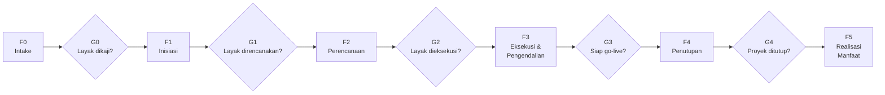

# 02 — Siklus Hidup Proyek & Stage Gate

Inti dari KIMPS. Enam fase (F0–F5) dipisahkan oleh lima gerbang keputusan (G0–G4).

## 1. Peta alur

Setiap gate menghasilkan salah satu dari tiga keputusan:

| Keputusan | Arti | Tindak lanjut |
|-----------|------|---------------|
| **GO** | Kriteria terpenuhi | Lanjut ke fase berikutnya |
| **GO bersyarat** | Ada kekurangan yang bisa diperbaiki sambil jalan | Lanjut, dengan daftar syarat bertanggal dan pemilik tindakan |
| **NO-GO / HOLD** | Kriteria pokok tidak terpenuhi | Kembali ke fase sebelumnya, ditunda, atau dihentikan permanen |

> Keputusan gate **wajib tercatat** dalam berita acara memakai
> [TPL-07 Gate Review Checklist](./templates/TPL-07-gate-review-checklist.md).
> Gate tanpa catatan keputusan dianggap belum dilewati.

---

## 2. Rincian fase

### F0 — Intake & Penyaringan

**Tujuan:** menyaring ide agar hanya yang layak yang menghabiskan sumber daya perencanaan.

- **Pemilik fase:** Pengusul (unit bisnis), difasilitasi PMD
- **Durasi acuan:** 1–2 minggu
- **Keluaran:** Formulir intake, skoring tier awal, penunjukan calon Sponsor

**Kegiatan pokok:**
1. Pengusul menyampaikan kebutuhan bisnis dan masalah yang hendak diselesaikan.
2. PMD memeriksa duplikasi dengan proyek berjalan atau yang sudah masuk antrean.
3. PMD melakukan skoring tier awal.
4. Penunjukan calon Project Sponsor.

#### Gate G0 — Approval to Assess
*Wajib untuk Tier 1. Opsional untuk Tier 2. Dilewati untuk Tier 3.*

| # | Kriteria kelulusan |
|---|--------------------|
| 1 | Masalah bisnis dinyatakan jelas, bukan sekadar usulan solusi |
| 2 | Tidak duplikat dengan inisiatif berjalan |
| 3 | Calon Sponsor teridentifikasi dan bersedia |
| 4 | Selaras dengan sasaran strategis atau kebutuhan kepatuhan |

---

### F1 — Inisiasi

**Tujuan:** mengubah ide menjadi proyek dengan batasan yang disepakati.

- **Pemilik fase:** Project Sponsor
- **Durasi acuan:** 2–4 minggu
- **Keluaran:** *Project Charter*, analisis kelayakan ringkas, peta pemangku kepentingan, risiko awal

**Kegiatan pokok:**
1. Menyusun *Project Charter* ([TPL-01](./templates/TPL-01-project-charter.md)).
2. Menetapkan sasaran, kriteria keberhasilan, dan batas lingkup (termasuk **yang tidak termasuk lingkup**).
3. Estimasi kasar biaya dan waktu (akurasi −25% s.d. +75%).
4. Identifikasi risiko tingkat tinggi dan pemangku kepentingan kunci.
5. Penunjukan Project Manager definitif.

#### Gate G1 — Approval to Plan
*Wajib untuk Tier 1 dan Tier 2.*

| # | Kriteria kelulusan |
|---|--------------------|
| 1 | *Project Charter* ditandatangani Sponsor |
| 2 | Sasaran terukur dan kriteria keberhasilan disepakati |
| 3 | Batas lingkup jelas, termasuk pengecualian |
| 4 | Estimasi kasar tersedia dan masuk akal terhadap kapasitas anggaran |
| 5 | Project Manager ditunjuk dan alokasi waktunya disepakati atasan langsungnya |

---

### F2 — Perencanaan

**Tujuan:** menyusun rencana yang cukup rinci untuk dieksekusi dan dikendalikan.

- **Pemilik fase:** Project Manager
- **Durasi acuan:** 3–8 minggu (bergantung tier)
- **Keluaran:** Rencana proyek terpadu, WBS, jadwal *baseline*, anggaran *baseline*, risk register, rencana komunikasi, rencana mutu, rencana pengadaan

**Kegiatan pokok:**
1. Menyusun WBS dan jadwal ([TPL-02](./templates/TPL-02-wbs-dan-jadwal.md)).
2. Menetapkan *baseline* biaya dengan akurasi −10% s.d. +15%.
3. Melengkapi risk register ([TPL-03](./templates/TPL-03-risk-register.md)) dengan rencana mitigasi.
4. Menetapkan struktur tim, RACI, dan irama rapat.
5. Menetapkan kriteria penerimaan (*acceptance criteria*) untuk setiap deliverable utama.
6. Menyiapkan rencana pengadaan bila melibatkan vendor.

#### Gate G2 — Approval to Execute
*Wajib untuk semua tier. Ini gate yang paling tidak boleh dikompromikan.*

| # | Kriteria kelulusan |
|---|--------------------|
| 1 | *Baseline* lingkup, jadwal, dan biaya ditetapkan dan disetujui |
| 2 | Anggaran tersedia dan terkonfirmasi oleh Finance |
| 3 | Sumber daya inti dialokasikan dengan persetujuan atasan masing-masing |
| 4 | Risk register lengkap, dengan pemilik dan mitigasi untuk setiap risiko tinggi |
| 5 | Kriteria penerimaan deliverable utama disepakati pengguna |
| 6 | Strategi pengadaan disetujui bila ada komponen vendor |

---

### F3 — Eksekusi & Pengendalian

**Tujuan:** menghasilkan deliverable sesuai *baseline*, sambil mengendalikan penyimpangan.

- **Pemilik fase:** Project Manager
- **Keluaran:** Deliverable proyek, laporan status berkala, log isu, catatan perubahan

**Kegiatan pokok:**
1. Mengelola pelaksanaan pekerjaan sesuai metode yang dipilih (waterfall / agile / hibrida).
2. Melaporkan status sesuai irama tier ([06 — KPI & Pelaporan](./06-kpi-dan-pelaporan.md)).
3. Mengelola risiko, isu, dan perubahan sesuai [05 — Proses Inti](./05-proses-inti.md).
4. Melakukan pengendalian mutu dan pengujian penerimaan.
5. Menyiapkan kesiapan operasional: pelatihan, dokumentasi, serah terima ke unit pengelola.

> **Aturan eskalasi.** Deviasi jadwal > 10% atau biaya > 5% terhadap *baseline*
> ⚠️ KALIBRASI wajib dieskalasi ke Steering Committee pada laporan berikutnya, tidak
> menunggu gate.

#### Gate G3 — Approval to Deploy / Go-Live
*Wajib untuk Tier 1 dan Tier 2.*

| # | Kriteria kelulusan |
|---|--------------------|
| 1 | Seluruh deliverable memenuhi kriteria penerimaan, atau penyimpangan disetujui tertulis |
| 2 | Pengujian penerimaan pengguna (UAT) lulus, cacat kritis nihil |
| 3 | Unit pengelola menyatakan siap menerima serah terima operasional |
| 4 | Pelatihan pengguna selesai dan dokumentasi tersedia |
| 5 | Rencana *rollback* atau kontinjensi tersedia |
| 6 | Tidak ada isu terbuka berkategori kritis |

---

### F4 — Penutupan

**Tujuan:** menutup proyek secara administratif dan mengunci pembelajaran.

- **Pemilik fase:** Project Manager, diverifikasi PMD
- **Durasi acuan:** 2–4 minggu setelah go-live
- **Keluaran:** Laporan penutupan, penyelesaian kontrak, *lessons learned*, pembubaran tim

**Kegiatan pokok:**
1. Menyusun laporan penutupan ([TPL-08](./templates/TPL-08-project-closure.md)).
2. Menyelesaikan seluruh kewajiban kontraktual dan pembayaran vendor.
3. Menyelenggarakan sesi *lessons learned* dengan tim dan pemangku kepentingan.
4. Mengarsipkan seluruh dokumen proyek ke KB PMD.
5. Melepaskan sumber daya tim secara resmi.

#### Gate G4 — Project Closed
*Wajib untuk semua tier.*

| # | Kriteria kelulusan |
|---|--------------------|
| 1 | Seluruh deliverable diserahterimakan dan diterima secara tertulis |
| 2 | Penyelesaian finansial tuntas; sisa anggaran dikembalikan |
| 3 | Kontrak vendor ditutup, tidak ada sengketa terbuka |
| 4 | *Lessons learned* terdokumentasi dan terarsip |
| 5 | Rencana pengukuran manfaat disepakati, dengan pemilik dan tanggal |

---

### F5 — Realisasi Manfaat

**Tujuan:** membuktikan proyek memberi hasil, bukan sekadar selesai.

- **Pemilik fase:** Project Sponsor (bukan lagi PM), difasilitasi PMD
- **Waktu pelaksanaan:** 3–12 bulan setelah go-live ⚠️ KALIBRASI
- **Keluaran:** *Post-Implementation Review*, laporan realisasi manfaat

Tanpa fase ini, organisasi tidak pernah tahu apakah investasi proyek terbayar. PMD
menjadwalkan dan memfasilitasi; Sponsor yang bertanggung jawab atas angkanya.

---

## 3. Penyesuaian gate per tier

| Gate | Tier 1 | Tier 2 | Tier 3 |
|------|--------|--------|--------|
| G0 | Wajib | Opsional | Dilewati |
| G1 | Wajib | Wajib | Digabung ke G2 |
| G2 | Wajib | Wajib | Wajib (bentuk ringkas) |
| G3 | Wajib | Wajib | Dilewati bila tanpa go-live |
| G4 | Wajib | Wajib | Wajib (bentuk ringkas) |

---

### Kendali Dokumen

| Atribut | Nilai |
|---------|-------|
| Versi | 0.1 (draft baseline) |
| Pemilik dokumen | Head of PMD ⚠️ KALIBRASI |
| Dokumen terkait | 01, 03, 04, 05, TPL-07 |
