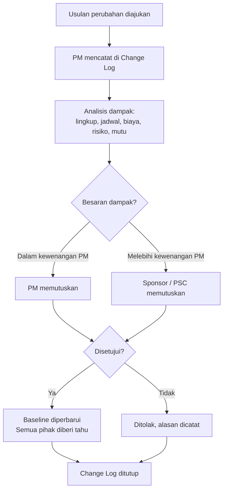

# 05 — Proses Inti Pengendalian Proyek

Delapan proses yang berjalan terus-menerus selama F2–F4.

---

## 1. Manajemen Risiko

**Definisi:** peristiwa *yang belum terjadi* dan dapat berdampak pada sasaran proyek.
(Bila sudah terjadi, itu **isu** — lihat §2.)

### Skala penilaian

| Skor | Kemungkinan | Dampak (biaya/jadwal/mutu) |
|:----:|-------------|----------------------------|
| 1 | Sangat kecil (< 10%) | Dapat diabaikan |
| 2 | Kecil (10–30%) | Minor; diserap cadangan |
| 3 | Sedang (30–60%) | Deviasi terlihat, masih terkendali |
| 4 | Besar (60–85%) | Melanggar *baseline*, perlu eskalasi |
| 5 | Hampir pasti (> 85%) | Mengancam kelangsungan proyek |

**Skor risiko = Kemungkinan × Dampak** (rentang 1–25)

| Skor | Kategori | Tindakan wajib |
|:----:|----------|----------------|
| 1–4 | Rendah | Pantau; tinjau bulanan |
| 5–9 | Sedang | Rencana mitigasi tertulis, ada pemilik |
| 10–15 | Tinggi | Mitigasi aktif + rencana kontinjensi; laporkan ke Sponsor |
| 16–25 | Ekstrem | Eskalasi ke PSC pada kesempatan pertama; pertimbangkan penghentian |

### Strategi penanganan

| Strategi | Kapan dipakai |
|----------|---------------|
| **Hindari** (*avoid*) | Ubah rencana agar risiko hilang |
| **Kurangi** (*mitigate*) | Turunkan kemungkinan atau dampaknya |
| **Alihkan** (*transfer*) | Asuransi, kontrak, jaminan pelaksanaan vendor |
| **Terima** (*accept*) | Biaya penanganan melebihi dampaknya; siapkan kontinjensi |

### Irama kerja
- Risk register ditinjau **setiap rapat tim proyek**.
- Risiko Tinggi dan Ekstrem ditinjau **formal setiap bulan** bersama Sponsor.
- Setiap risiko wajib punya **satu** pemilik bernama — bukan nama unit.

Gunakan [TPL-03 Risk Register](./templates/TPL-03-risk-register.md).

---

## 2. Manajemen Isu

**Definisi:** masalah yang **sudah terjadi** dan menghambat kemajuan.

| Prioritas | Kriteria | Batas waktu penyelesaian ⚠️ KALIBRASI |
|-----------|----------|---------------------------------------|
| **Kritis** | Pekerjaan terhenti; go-live terancam | 24 jam untuk rencana tindakan |
| **Tinggi** | Jalur kritis terdampak | 3 hari kerja |
| **Sedang** | Ada dampak, masih ada jalan memutar | 10 hari kerja |
| **Rendah** | Gangguan minor | Sesuai kapasitas |

Aturan:
1. Setiap isu punya pemilik dan tanggal target. Isu tanpa tanggal target dianggap belum tercatat.
2. Isu kritis dilaporkan ke Sponsor **hari itu juga**, tidak menunggu laporan berkala.
3. Isu yang tidak selesai melewati batas waktu naik satu tingkat prioritas secara otomatis.

Gunakan [TPL-04 Issue Log](./templates/TPL-04-issue-log.md).

---

## 3. Manajemen Perubahan (*Change Control*)

Berlaku sejak *baseline* ditetapkan di Gate G2. Sebelum itu, perubahan adalah bagian normal
dari perencanaan.

### Alur

Aturan tegas:
1. **Tidak ada pekerjaan tambahan tanpa CR yang disetujui.** Permintaan lisan dari pihak
   mana pun tidak mengikat tim proyek.
2. Analisis dampak wajib mencakup kelima dimensi: lingkup, jadwal, biaya, risiko, mutu.
   Menyebut satu dimensi saja (biasanya biaya) tidak cukup.
3. *Baseline* hanya berubah melalui CR yang disetujui. Jadwal yang "digeser diam-diam"
   adalah pelanggaran proses.
4. Batas kewenangan persetujuan: lihat [03 §3](./03-governance-dan-raci.md#3-batas-kewenangan-perubahan-delegation-of-authority).

Gunakan [TPL-05 Change Request](./templates/TPL-05-change-request.md).

---

## 4. Manajemen Jadwal

- **Baseline** ditetapkan di Gate G2 dan disimpan terpisah dari jadwal berjalan.
- **Jalur kritis** wajib diidentifikasi dan dipantau untuk Tier 1 dan Tier 2.
- **Cadangan waktu** (*schedule buffer*) ditempatkan di tingkat proyek, bukan disembunyikan
  di setiap aktivitas. Usulan: 10–15% dari durasi jalur kritis ⚠️ KALIBRASI.
- **Pengukuran kemajuan** memakai penyelesaian *milestone*, bukan persentase yang
  dilaporkan sendiri oleh pelaksana. Aktivitas hanya punya dua status: **belum selesai**
  atau **selesai** (aturan 0/100) untuk aktivitas ≤ 2 minggu.
- **Indikator:** *Schedule Performance Index* (SPI) untuk Tier 1. SPI < 0,9 memicu
  tinjauan pemulihan jadwal.

---

## 5. Manajemen Biaya

- **Baseline** anggaran ditetapkan di Gate G2 dengan akurasi −10% s.d. +15%.
- **Struktur cadangan:**
  | Jenis | Besaran usulan ⚠️ KALIBRASI | Pengendali |
  |-------|------------------------------|------------|
  | Cadangan kontinjensi (risiko teridentifikasi) | 5–10% dari nilai proyek | Project Manager |
  | Cadangan manajemen (risiko tak teridentifikasi) | 5% dari nilai proyek | Project Sponsor |
- **Pelaporan:** realisasi vs *baseline* vs proyeksi sampai selesai (*Estimate at
  Completion*) pada setiap laporan status.
- **Indikator:** *Cost Performance Index* (CPI) untuk Tier 1. CPI < 0,95 memicu tinjauan biaya.
- **Komitmen vs realisasi** dilaporkan terpisah. Pesanan pembelian yang sudah diterbitkan
  adalah komitmen, meski belum dibayar.

---

## 6. Manajemen Mutu

1. **Kriteria penerimaan ditetapkan di F2**, bukan menjelang serah terima. Kriteria yang
   dirumuskan belakangan selalu memihak pihak yang paling keras bersuara.
2. **Dua lapis pemeriksaan:**
   - *Quality Control* — pemeriksaan deliverable (pengujian, inspeksi, tinjauan sejawat)
   - *Quality Assurance* — pemeriksaan proses, dilakukan PMD melalui gate review
3. **Klasifikasi cacat:**
   | Kategori | Arti | Dampak pada G3 |
   |----------|------|----------------|
   | Kritis | Fungsi utama tidak jalan; risiko keamanan atau kepatuhan | Menahan go-live |
   | Mayor | Fungsi penting terganggu, ada penanganan sementara | Perlu persetujuan tertulis Sponsor |
   | Minor | Gangguan kosmetik atau kenyamanan | Boleh masuk daftar perbaikan pasca go-live |
4. **UAT dijalankan oleh pengguna**, difasilitasi tim proyek. Tim proyek tidak boleh
   menguji pekerjaannya sendiri lalu menyatakan lulus.

---

## 7. Manajemen Pemangku Kepentingan & Komunikasi

### Pemetaan

| | **Pengaruh rendah** | **Pengaruh tinggi** |
|---|---|---|
| **Minat tinggi** | Beri informasi rutin | **Kelola erat** — libatkan dalam keputusan |
| **Minat rendah** | Pantau, informasi minimal | Jaga kepuasan — laporkan hal penting saja |

### Matriks komunikasi

| Sasaran | Isi | Saluran | Frekuensi | Penanggung jawab |
|---------|-----|---------|-----------|------------------|
| Tim proyek | Rencana kerja, hambatan | Rapat tim | Mingguan | PM |
| Sponsor | Status, risiko, keputusan yang dibutuhkan | Laporan + rapat | Sesuai tier | PM |
| PSC | Ringkasan eksekutif, eskalasi | Paparan | Bulanan / per gate | PM |
| Pengguna terdampak | Perubahan cara kerja, jadwal pelatihan | Surel, sosialisasi | Per *milestone* | Business Owner |
| Vendor | Instruksi kerja, umpan balik | Rapat koordinasi | Sesuai kontrak | PM |
| Organisasi luas | Capaian penting | Kanal internal | Per *milestone* besar | Sponsor |

**Aturan kabar buruk:** disampaikan lebih awal, langsung, dan disertai opsi penanganan.
Kabar buruk yang ditunda selalu berbiaya lebih mahal.

---

## 8. Manajemen Pengadaan & Vendor

1. **Rencana pengadaan disusun di F2** dan disetujui di Gate G2 — bukan saat kebutuhan
   sudah mendesak.
2. **Pemisahan peran:** PM menetapkan kebutuhan teknis; Procurement menjalankan proses
   pemilihan dan kontrak. PM tidak bernegosiasi harga sendiri.
3. **Kriteria evaluasi ditetapkan sebelum penawaran dibuka**, dengan bobot yang disepakati.
4. **Pengelolaan kinerja vendor** selama eksekusi: tinjauan berkala terhadap jadwal, mutu,
   dan kepatuhan kontrak. Temuan dicatat sebagai isu, bukan keluhan lisan.
5. **Pembayaran dikaitkan dengan penerimaan deliverable**, bukan dengan berjalannya waktu.
6. **Penutupan kontrak di F4** wajib tuntas sebelum Gate G4: tidak ada pekerjaan tertunda,
   tidak ada sengketa terbuka, jaminan pemeliharaan tercatat.

---

### Kendali Dokumen

| Atribut | Nilai |
|---------|-------|
| Versi | 0.1 (draft baseline) |
| Pemilik dokumen | Head of PMD ⚠️ KALIBRASI |
| Dokumen terkait | 02, 03, TPL-03, TPL-04, TPL-05 |
