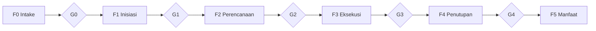

# KIMPS — Blueprint Metodologi Manajemen Proyek

Standar metodologi manajemen proyek PMD Department. **Status: Draft baseline v0.1.**

## Mulai dari mana

| Anda adalah... | Baca ini |
|----------------|----------|
| Baru mengenal KIMPS | [00 — Gambaran Umum](./00-overview.md) → [02 — Siklus Hidup & Gate](./02-lifecycle-dan-gate.md) → [04 — Matriks Artefak](./04-matriks-artefak.md) |
| Akan memulai proyek baru | [01 — Klasifikasi Proyek](./01-klasifikasi-proyek.md) → [TPL-01 Project Charter](./templates/TPL-01-project-charter.md) |
| Sedang menjalankan proyek | [05 — Proses Inti](./05-proses-inti.md) → [06 — KPI & Pelaporan](./06-kpi-dan-pelaporan.md) |
| Sponsor / anggota Steering Committee | [03 — Tata Kelola & RACI](./03-governance-dan-raci.md) → [02 §2 kriteria gate](./02-lifecycle-dan-gate.md#2-rincian-fase) |
| Akan menerapkan KIMPS di organisasi | [07 — Roadmap Adopsi](./07-roadmap-adopsi.md) |

## Daftar isi

**Dokumen inti**

0. [Gambaran Umum](./00-overview.md) — tujuan, prinsip, ruang lingkup
1. [Klasifikasi Proyek](./01-klasifikasi-proyek.md) — tiering dan penyesuaian beban proses
2. [Siklus Hidup & Stage Gate](./02-lifecycle-dan-gate.md) — fase F0–F5, gate G0–G4
3. [Tata Kelola & RACI](./03-governance-dan-raci.md) — peran, forum, batas kewenangan
4. [Matriks Artefak](./04-matriks-artefak.md) — dokumen wajib per fase per tier
5. [Proses Inti](./05-proses-inti.md) — risiko, isu, perubahan, jadwal, biaya, mutu, komunikasi, vendor
6. [KPI & Pelaporan](./06-kpi-dan-pelaporan.md) — metrik, status warna, irama laporan
7. [Roadmap Adopsi](./07-roadmap-adopsi.md) — tahapan penerapan
8. [Glosarium](./08-glosarium.md) — definisi baku

**Template** — lihat [`templates/`](./templates/README.md)

## Ringkasan alur

## Penanda ⚠️ KALIBRASI

Dokumen ini memuat sejumlah angka ambang, nama jabatan, dan batas kewenangan yang **masih
berupa usulan awal**. Seluruhnya ditandai `⚠️ KALIBRASI` dan wajib diputuskan PMD bersama
pemangku kepentingan sebelum blueprint diberlakukan resmi. Daftar lengkap butir yang perlu
dikalibrasi ada di [07 §2 — Tahap T1](./07-roadmap-adopsi.md#t1--kalibrasi).
